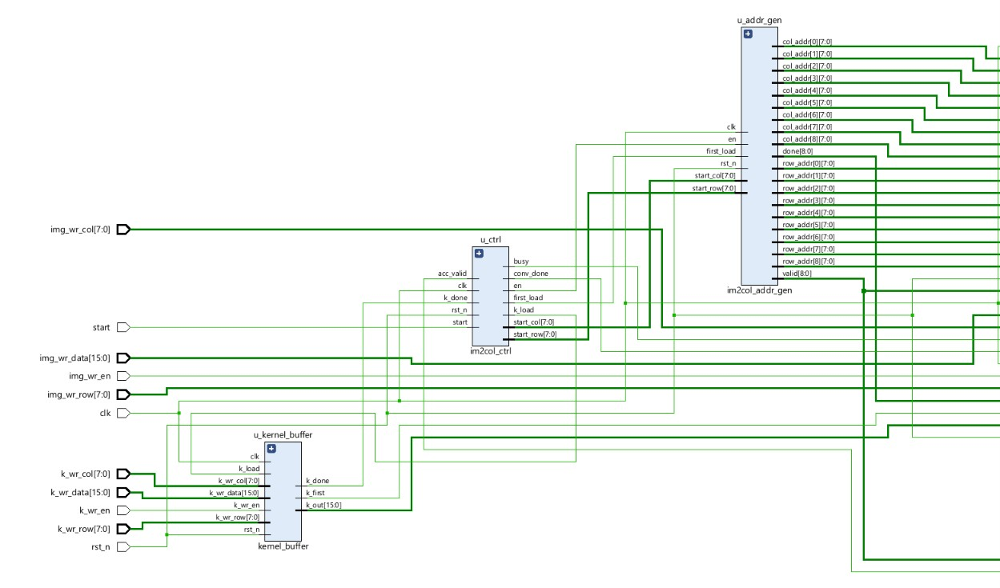
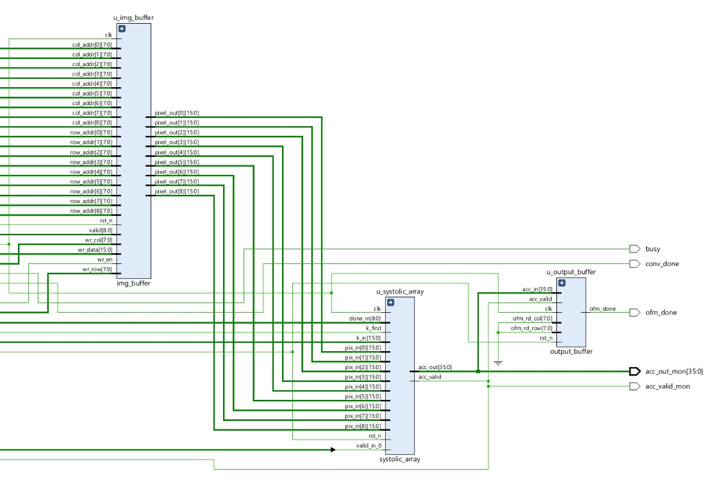
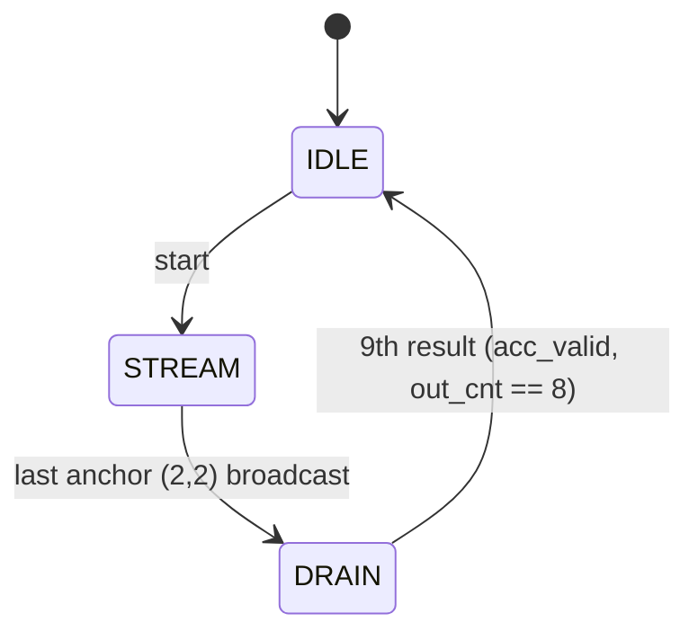
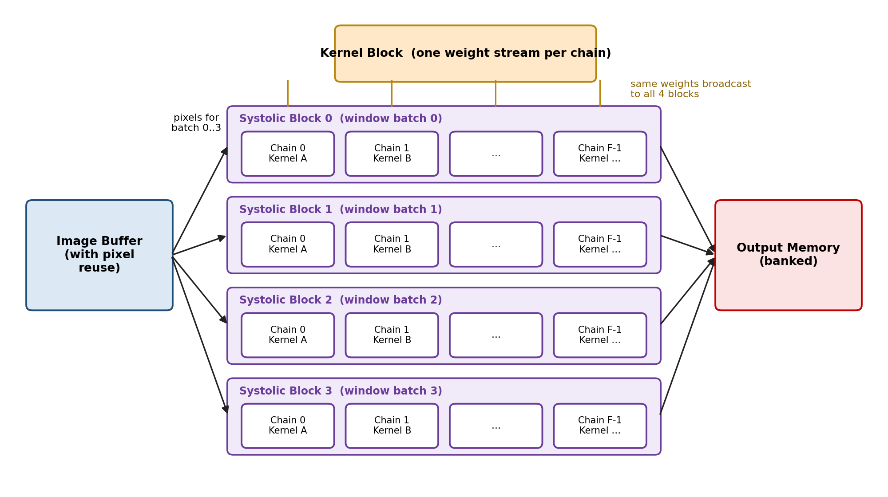

## Convolutional Neural Network Hardware Accelerator for a 5×5 image with a 3×3 kernel filter


*Original architecture concept. The implemented RTL and its Vivado schematics are shown in [System Architecture](#system-architecture).*

**Language:** SystemVerilog · **RTL schematic:** Xilinx Vivado · **Planned physical flow:** Cadence Genus / Innovus

---

## Table of Contents

- [Overview](#overview)
- [Key Features](#key-features)
- [Repository Structure](#repository-structure)
- [Background](#background)
- [System Architecture](#system-architecture)
- [Module Reference](#module-reference)
- [Dataflow and Timing](#dataflow-and-timing)
- [Parameters](#parameters)
- [Top-Level Interface](#top-level-interface)
- [Operation Sequence](#operation-sequence)
- [Default Simulation Data and Expected Output](#default-simulation-data-and-expected-output)
- [Design Notes and Known Limitations](#design-notes-and-known-limitations)
- [Project Status](#project-status)
- [Future Work](#future-work)
- [Implementation Results](#implementation-results)
- [References](#references)
- [Glossary](#glossary)

---

## Overview

Convolution accounts for most of the computation in a convolutional neural network (CNN), which makes it the main target for hardware acceleration. This project is a hardware accelerator, written in SystemVerilog, that performs 2-D convolution of a single-channel (grayscale) 5×5 image with a 3×3 kernel (stride 1, no padding), producing a 3×3 output.

The design combines two well-established techniques:

- **Implicit Im2Col addressing** – pixel addresses are generated on the fly by a chain of small address generators instead of building an Im2Col matrix in memory.
- **1-D output-stationary systolic array** – a chain of nine processing elements (PEs), one per output window. Each PE accumulates its own output while the kernel weights (and their control signals) flow down the chain with a one-cycle skew.

| Item | Value (default configuration) |
|------|-------------------------------|
| Input | Single-channel 5×5 image |
| Kernel | 3×3, stride 1, no padding |
| Data width | 16-bit signed (`DATA_W`) |
| Accumulator width | 36-bit signed (`ACC_W = 2·16 + ⌈log₂ 9⌉`) |
| Output | 3×3 (9 windows × 9 MACs = 81 MACs) |
| PEs | 9 (`NUM_GENS`), one per window |
| Compute latency | 18 cycles from the first `STREAM` cycle to the last result |

## Key Features

- Clean separation of control, address generation, image storage, kernel streaming, computation, and output storage
- Systolic ring of nine `mini_addr_gen` units: each one starts one cycle after the previous and latches its own window anchor from a shared bus
- Single kernel read port regardless of PE count – weights, clear and enable flags travel down the PE chain
- Results leave the array **one per cycle, in row-major window order**, through a serial `acc_out` / `acc_valid` interface
- Optional ReLU on the stored output feature map (`EN_RELU`)
- Status outputs: `busy`, `conv_done`, `ofm_done`, plus an `acc_out_mon` / `acc_valid_mon` monitor stream

## Repository Structure

```
.
├── README.md
├── top.sv              # cnn_top            – top-level integration
├── control_block.sv    # im2col_ctrl        – master FSM and window-anchor counter
├── im2col.sv           # im2col_addr_gen    – ring of 9 mini_addr_gen units
├── mini_addr_gen.sv    # mini_addr_gen      – 3×3 tap address stepper (used by image and kernel paths)
├── image_buffer.sv     # img_buffer         – image storage with 9 combinational read ports
├── kernel_buffer.sv    # kernel_buffer      – 3×3 weight storage and weight streamer
├── pe.sv               # pe                 – multiply-accumulate processing element
├── Systolicarray.sv    # systolic_array     – chain of 9 PEs and result serializer
├── output_buffer.sv    # output_buffer      – 3×3 output feature map memory with optional ReLU
└── docs/
    ├── CNN_Accelerator_Project_Report.docx   # Initial design specification (early plan, see note below)
    └── images/
        ├── top_level_architecture.png        # Original architecture concept
        ├── scaled_architecture.png           # Future-work scaled architecture
        ├── vivado_schematic_part1.jpg        # Vivado schematic: control, address generation, kernel buffer
        └── vivado_schematic_part2.jpg        # Vivado schematic: image buffer, systolic array, output buffer
```

> **Note on the report in `docs/`:** it is the specification written at the start of the project. The implementation has since evolved (data/accumulator widths, FSM, interface, result path). **This README describes the RTL as it is implemented now.**

## Background

### 2-D Convolution

For an input image `I` and a `K×K` kernel `W` with stride `S`:

```
O[r][c] = Σ(i=0..K−1) Σ(j=0..K−1)  I[r·S + i][c·S + j] × W[i][j]

OUT_H = (IMG_H − K) / S + 1
OUT_W = (IMG_W − K) / S + 1
```

With stride 1, two horizontally adjacent windows share six of their nine pixels – a major opportunity for data reuse in hardware.

### Im2Col

Im2Col unrolls each window into a column so convolution becomes a matrix multiplication. Explicit Im2Col costs memory (for a 3×3 kernel with stride 1 the matrix is ~9× larger than the image). **Implicit Im2Col** never builds the matrix: address generators compute, every cycle, which original pixel each window entry corresponds to and read it directly from the image buffer. This project uses implicit Im2Col.

### Systolic Dataflows

| Dataflow | Stays in the PE | Moves between PEs | Typical benefit |
|----------|-----------------|-------------------|-----------------|
| Weight-stationary | Weights | Pixels and partial sums | Each weight fetched once, reused for many windows |
| **Output-stationary** (this design) | Partial sums | Weights (and control) | Partial sums never leave the PE until final |
| Input-stationary | Pixels | Weights and partial sums | Each pixel fetched once, reused for many weights |

Output-stationary avoids moving wide partial sums between PEs and extends naturally to multi-channel convolution, since a PE simply keeps accumulating across channels.

## System Architecture

The Vivado schematics below are generated from the implemented RTL. The design has six blocks under `cnn_top`:

| Instance | Module | Role |
|----------|--------|------|
| `u_ctrl` | `im2col_ctrl` | Master FSM; steps the window-anchor bus; starts the address generators and the kernel streamer |
| `u_addr_gen` | `im2col_addr_gen` | Nine chained `mini_addr_gen` units producing a (row, col) address and valid/done flags for each PE |
| `u_img_buffer` | `img_buffer` | Stores the image; nine combinational read ports, one per PE |
| `u_kernel_buffer` | `kernel_buffer` | Stores the 3×3 weights; streams one weight per cycle into PE0 |
| `u_systolic_array` | `systolic_array` | Nine PEs plus a one-hot result mux |
| `u_output_buffer` | `output_buffer` | 3×3 output memory with optional ReLU; asserts `ofm_done` |

### Vivado Schematic (1/2) – Control, Address Generation, Kernel Buffer



*Figure 1. Left half of the elaborated design. `u_ctrl` takes `start` and drives `en`, `first_load`, `start_row[7:0]`, `start_col[7:0]` and `k_load`. `u_addr_gen` produces `row_addr[0..8]`, `col_addr[0..8]`, `valid[8:0]` and `done[8:0]`. `u_kernel_buffer` has its own write port (`k_wr_*`) and returns `k_out`, `k_first`, and `k_done` (fed back to the controller). The image write port (`img_wr_*`) is routed to the image buffer on the right.*

### Vivado Schematic (2/2) – Image Buffer, Systolic Array, Output Buffer



*Figure 2. Right half of the elaborated design. The nine address pairs from `u_addr_gen` enter `u_img_buffer`, whose nine `pixel_out[0..8]` buses feed `pix_in[0..8]` of `u_systolic_array`. The array also receives `k_in`, `k_first`, `valid_in_0` (= `valid[0]`) and `done_in[8:0]`, and returns the serialized `acc_out[35:0]` / `acc_valid`. These drive `u_output_buffer` and the `acc_out_mon` / `acc_valid_mon` ports. `busy` and `conv_done` come from `u_ctrl`; `ofm_done` comes from `u_output_buffer`. The output buffer's read-address inputs (`ofm_rd_row`, `ofm_rd_col`) are tied to ground at the top level.*

> The block diagram at the top of this README is the original architectural concept. Two differences in the implementation: PE results are serialized by a one-hot mux inside `systolic_array` (not read from PE8 alone), and the image buffer is read combinationally instead of with 1-cycle latency.

### Module hierarchy

```
cnn_top
├── im2col_ctrl       u_ctrl
├── im2col_addr_gen   u_addr_gen
│   └── mini_addr_gen   ×9
├── img_buffer        u_img_buffer
├── kernel_buffer     u_kernel_buffer
│   └── mini_addr_gen   u_kernel_addr_gen
├── systolic_array    u_systolic_array
│   └── pe              ×9
└── output_buffer     u_output_buffer
```

## Module Reference

### `im2col_ctrl` – Control (`control_block.sv`)

A three-state FSM plus the window-anchor counter.



| State | Activity | Exit condition |
|-------|----------|----------------|
| `IDLE` | Outputs cleared; waits for `start` | `start` pulse → sets `en = 1`, `first_load = 1` |
| `STREAM` | `start_row` / `start_col` step through all 9 window anchors, **one per clock**, row-major (0,0) → (2,2). `first_load` is high only on the first cycle | After anchor (2,2): `en` drops, go to `DRAIN` |
| `DRAIN` | Waits for the remaining PE results; `out_cnt` counts `acc_valid` pulses | `acc_valid` with `out_cnt == TOTAL_WIN−1` → `IDLE` |

Other outputs:

- `busy` – high whenever the state is not `IDLE`
- `conv_done` – high on the final valid result cycle (`acc_valid` with `out_cnt == 8`)
- `k_load = first_load | (k_done_d & en)` – starts the kernel streamer on kickoff, and re-triggers it after each 9-tap pass while windows remain (multi-batch)

### `mini_addr_gen` – Tap address stepper (`mini_addr_gen.sv`)

On `load`, it outputs the anchor `(start_row, start_col)` **combinationally in the same cycle** (tap 0) and then steps through the remaining eight taps row-major: `col+1`, `col+2`, wrap to `base_col` and `row+1`, … It outputs:

- `valid` – high for all 9 tap cycles
- `row_addr`, `col_addr` – current tap address
- `done` – pulses on tap 8
- `load_out` – `load` delayed by one cycle, used to trigger the next generator in the ring

### `im2col_addr_gen` – Address generator ring (`im2col.sv`)

Nine `mini_addr_gen` units share the `start_row` / `start_col` anchor bus. Generator 0 loads on `first_load` (or when generator 8's delayed trigger comes back while `en` is still high); generator *i* loads one cycle after generator *i−1*. Because the anchor bus advances by one window every cycle, **generator *i* latches window anchor *i*** in row-major order, so PE *i* computes window *i* (PE0 → (0,0), PE1 → (0,1), … PE8 → (2,2)). No dividers or modulo logic are needed.

### `img_buffer` – Image buffer (`image_buffer.sv`)

- `mem[IMG_H][IMG_W]` of `DATA_WIDTH` bits, built from flip-flops
- One synchronous write port (`wr_en`, `wr_row`, `wr_col`, `wr_data`) with bounds checking
- **Nine combinational read ports**: `pixel_out[i]` returns the pixel at `(row_addr[i], col_addr[i])` when `valid[i]` is high and the address is in range, else 0
- `initial` block preloads the image with values 1…25 for simulation

### `kernel_buffer` – Kernel buffer (`kernel_buffer.sv`)

- `k_mem[3][3]` of signed `DATA_W` bits, one synchronous write port (`k_wr_*`) with bounds checking
- Contains its own `mini_addr_gen` hardwired to start at (0,0); `k_load` starts a 9-cycle scan
- `k_out` is a combinational read of the current weight (0 when not valid); `k_first = k_load` marks the first weight of a window and acts as the PE **clear** signal
- `initial` block preloads the kernel with 1…9 for simulation

### `pe` – Processing element (`pe.sv`)

- Signed multiply `pix_in × k_in` (`2·DATA_W` bits), accumulated into an `ACC_W`-bit register
- When `en_in` is high: `clr_in` starts a new window (`acc <= prod`), otherwise `acc <= acc + prod`
- Registers `k_in`, `clr_in` and `en_in` and forwards them (`k_out`, `clr_out`, `en_out`) – this single register stage per PE creates the systolic skew
- Asynchronous active-low reset

### `systolic_array` – PE chain and result serializer (`Systolicarray.sv`)

- Nine PEs generated with a `generate` loop; weight, clear and enable chains are arrays indexed by PE number
- PE0 is fed by `k_in`, `k_first` (clear) and `valid_in_0` (enable); PEs 1–8 receive them from the previous PE
- `done_in[i]` (from the address generators) is registered and used as a one-hot select: the PE that just finished its 9th tap drives `acc_out`, and `acc_valid = |pe_done_d`

### `output_buffer` – Output feature map (`output_buffer.sv`)

- `out_mem[OUT_H][OUT_W]` of signed `ACC_W` bits with an internal row/column write pointer that advances on every `acc_valid`
- `EN_RELU` (default `1`): negative sums are stored as 0. Note that `acc_out_mon` carries the **raw** (pre-ReLU) value
- `ofm_done` – high when the last output (2,2) is being written
- Combinational read port (`ofm_rd_row`, `ofm_rd_col` → `ofm_rd_data`); not connected at the top level (see [limitations](#design-notes-and-known-limitations))

## Dataflow and Timing

Cycle numbers are relative to the first `STREAM` cycle (cycle 0 = the cycle in which `first_load` is high, directly after `start` is sampled).

### Weight skew

One weight is streamed into PE0 per cycle. Each PE registers it for one cycle and forwards it, so **at cycle `t`, PE `p` receives weight `K(t − p)`**:

| Cycle | PE0 | PE1 | PE2 | PE3 | … | PE8 |
|-------|-----|-----|-----|-----|---|-----|
| 0 | K0 | – | – | – | | – |
| 1 | K1 | K0 | – | – | | – |
| 2 | K2 | K1 | K0 | – | | – |
| 8 | K8 | K7 | K6 | K5 | | K0 |
| 9 | – | K8 | K7 | K6 | | K1 |
| 16 | – | – | – | – | | K8 |

The address generators are chained with the same one-cycle delay (generator *i* loads at cycle *i*). Since the image buffer is read combinationally, the pixel for PE *i* arrives in the same cycle as its weight, and **no extra alignment registers are needed**.

### Result timing

| Event | Cycle |
|-------|-------|
| `start` sampled → `STREAM`, `first_load` = 1, PE0 starts window 0 | 0 |
| PE *i* starts its window | *i* |
| `done[i]` from the address generator (PE *i* is on its 9th tap) | 8 + *i* |
| `pe_done_d[i]` high, `acc_out` = window *i* result, `acc_valid` = 1 | 9 + *i* (9 … 17) |
| `conv_done` and `ofm_done` | 17 |

One computation takes `K² + P − 1 = 17` compute cycles plus 1 cycle for the registered `done`, i.e. **18 cycles**, performing 81 MACs out of 9 × 17 = 153 slots (~53 % utilization). With multi-batch operation the chain restarts PE0 at cycle 9, so fill and drain overlap and utilization approaches 100 %.

### Pixel sharing (basis for the pixel-reuse optimization)

PE `p = 3a + b` handles the window at row `a`, column `b` and at cycle `t` uses weight `k = t − p = 3i + j`. The pixel it needs is `(R, C) = (a + i, b + j)`, so

```
t = p + k = 3(a + i) + (b + j) = 3R + C
```

Every active PE at cycle `t` needs a pixel with `3R + C = t`; with `C ∈ [0, 4]` there are **at most two distinct pixels per cycle**, and every pixel is needed in exactly one cycle (9×1 + 8×2 = 25 reads instead of 81).

## Parameters

| Parameter | Module | Default | Meaning |
|-----------|--------|---------|---------|
| `IMG_H`, `IMG_W` | `cnn_top` and blocks | 5, 5 | Image height and width |
| `KERNEL_SZ` | `cnn_top` and blocks | 3 | Kernel size (K × K) |
| `DATA_W` | `cnn_top` and blocks | 16 | Pixel and weight width (bits) |
| `ACC_W` | `cnn_top` and blocks | 36 | Accumulator / output width. Set manually; `2·DATA_W + ⌈log₂(K²)⌉ = 36` |
| `ADDR_WIDTH` | `cnn_top` and blocks | 8 | Width of every row/column address bus |
| `NUM_GENS` | `cnn_top`, `im2col_addr_gen` | 9 | Number of address generators = number of PEs (passed to `systolic_array` as `NUM_WIN`) |
| `EN_RELU` | `output_buffer` | 1 | Clip negative outputs to 0 when stored (not exposed by `cnn_top`) |

Derived inside the blocks: `MAX_ROW = IMG_H − K`, `MAX_COL = IMG_W − K`, `TOTAL_WIN = (MAX_ROW+1)·(MAX_COL+1)` (`im2col_ctrl`); `OUT_H = IMG_H − K + 1`, `OUT_W = IMG_W − K + 1` (`output_buffer`).

## Top-Level Interface

Module `cnn_top`:

| Group | Signal | Dir | Width | Purpose |
|-------|--------|-----|-------|---------|
| Control | `clk` | in | 1 | System clock |
| Control | `rst_n` | in | 1 | Active-low asynchronous reset |
| Control | `start` | in | 1 | One-cycle pulse to begin (accepted in `IDLE`) |
| Status | `busy` | out | 1 | High while the accelerator is running |
| Status | `conv_done` | out | 1 | Pulses on the last valid result cycle |
| Image load | `img_wr_en` | in | 1 | Image write enable |
| Image load | `img_wr_row`, `img_wr_col` | in | 8, 8 | Pixel coordinates |
| Image load | `img_wr_data` | in | 16 | Pixel value |
| Kernel load | `k_wr_en` | in | 1 | Kernel write enable |
| Kernel load | `k_wr_row`, `k_wr_col` | in | 8, 8 | Weight coordinates |
| Kernel load | `k_wr_data` | in | 16 (signed) | Weight value |
| Result | `acc_out_mon` | out | 36 (signed) | Serialized convolution results (pre-ReLU) |
| Result | `acc_valid_mon` | out | 1 | `acc_out_mon` carries a finished result |
| Result | `ofm_done` | out | 1 | Last output feature map element is being written |

## Operation Sequence

1. Assert `rst_n` low, then release it – the FSM enters `IDLE`.
2. *(Optional – the buffers are preloaded for simulation)* write the 25 pixels with `img_wr_en` / `img_wr_row` / `img_wr_col` / `img_wr_data`, and the 9 weights with `k_wr_en` / `k_wr_row` / `k_wr_col` / `k_wr_data`, one element per cycle.
3. Pulse `start` for one cycle while the FSM is in `IDLE`.
4. `busy` goes high. Starting 9 cycles later, one result per cycle appears on `acc_out_mon` while `acc_valid_mon` is high, in row-major window order: O[0][0], O[0][1], …, O[2][2].
5. `conv_done` and `ofm_done` pulse with the 9th result, then `busy` drops and the FSM returns to `IDLE`.

## Default Simulation Data and Expected Output

With no external writes, the buffers hold the preloaded data: image `I[r][c] = 5r + c + 1` (values 1…25 row-major) and kernel `K[i][j] = 3i + j + 1` (values 1…9). The 9 results on `acc_out_mon` should be:

| | col 0 | col 1 | col 2 |
|---|-------|-------|-------|
| row 0 | 411 | 456 | 501 |
| row 1 | 636 | 681 | 726 |
| row 2 | 861 | 906 | 951 |

PE0 MAC sequence for window (0,0) (pixels 1, 2, 3, 6, 7, 8, 11, 12, 13):

| Step k | Weight | Pixel | Product | Accumulator |
|--------|--------|-------|---------|-------------|
| 0 | 1 | 1 | 1 | 1 |
| 1 | 2 | 2 | 4 | 5 |
| 2 | 3 | 3 | 9 | 14 |
| 3 | 4 | 6 | 24 | 38 |
| 4 | 5 | 7 | 35 | 73 |
| 5 | 6 | 8 | 48 | 121 |
| 6 | 7 | 11 | 77 | 198 |
| 7 | 8 | 12 | 96 | 294 |
| 8 | 9 | 13 | 117 | **411** → O[0][0] |

All values here are positive, so the ReLU in `output_buffer` does not change them. For signed test data (for example the Sobel kernel `[1 0 −1; 2 0 −2; 1 0 −1]`), `acc_out_mon` shows the raw result while `out_mem` stores it clipped at 0 unless `EN_RELU` is set to 0.

## Design Notes and Known Limitations

- **Output memory is not readable from outside.** At the top level `ofm_rd_row` / `ofm_rd_col` are tied to 0 and `ofm_rd_data`, `wr_row_mon`, `wr_col_mon` are left unconnected (visible in Figure 2). Results are observed through the `acc_out_mon` stream. To read the stored (ReLU'd) output feature map, expose the read port at the top.
- **`EN_RELU` is not a top-level parameter.** It defaults to 1 inside `output_buffer`; change the default or pass it through `cnn_top` to disable ReLU.
- **`mini_addr_gen` is hardwired to a 3×3 tap pattern** (2-bit step counters compared against 2). `KERNEL_SZ` is therefore only meaningful for K = 3 at the moment.
- **`ACC_W` is not computed from `DATA_W` and `KERNEL_SZ`;** keep it consistent manually (`2·DATA_W + ⌈log₂ K²⌉`).
- **Pixels are stored as raw 16-bit values and cast to signed in `cnn_top`,** so pixel values above 32767 would be interpreted as negative.
- **Buffer preloads are simulation-only.** The `initial` blocks that fill the image and kernel memories with 1…25 and 1…9 are not synthesizable as register reset values; in hardware the buffers must be loaded through the write ports.
- **Long combinational path.** Image reads are combinational, so the path address generator → 25-to-1 read mux → 16×16 multiplier → 36-bit adder is in a single cycle. This is the expected critical path for synthesis; registering the pixel read (and delaying the weights by one stage) is the standard fix if timing requires it.
- **Nine read ports.** Each is effectively a 25-to-1 mux of 16-bit values over 400 flip-flops; read logic grows with PE count and image size (see pixel reuse below).
- **PEs tied to windows.** `NUM_GENS` equals the number of windows in the baseline. The ring re-trigger and kernel re-trigger logic in the control path are intended for processing more windows than PEs in batches, but the documented configuration is the 9-window 5×5 case.
- **Single channel, single kernel.** Multi-channel input and multiple filters are future work.
- **No design-for-test** in the baseline.

## Project Status

- [x] RTL – all blocks implemented (this repository)
- [x] Elaboration and schematic review in Vivado (Figures 1 and 2)
- [ ] Python/NumPy reference model and self-checking testbench
- [ ] Logic synthesis (Cadence Genus) – clock sweep, area/timing/power reports
- [ ] Logic equivalence check (RTL vs netlist)
- [ ] Place and route (Cadence Innovus), signoff (STA, DRC, LVS), GDSII

Suggested verification cases once the testbench exists: the default data above, random images and kernels, all-zero image or kernel, maximum-magnitude values, negative weights, back-to-back jobs, and an identity kernel (centre weight = 1) to check the address generation.

## Future Work

### Pixel Reuse

Because at most two distinct pixels are needed in any cycle (see [Pixel sharing](#pixel-sharing-basis-for-the-pixel-reuse-optimization)), the nine independent read muxes can be replaced by two pixel buses plus a 2-to-1 selector per PE, cutting pixel reads from 81 to 25 per computation (~3.2×). For other image/kernel sizes the pattern must be re-derived; a line buffer is the standard general solution.

### Scaled Architecture



*Figure 3. Scaled architecture: four systolic blocks, each with F kernel chains.*

- **Window parallelism** – four systolic blocks process four window batches simultaneously, with weights broadcast from one kernel stream.
- **Filter parallelism** – inside each block, `F` PE chains apply `F` different kernels to the same windows and share one set of pixel ports.

This requires pixel reuse (to keep read logic manageable) and a banked output memory (up to `4F` results per cycle).

### Other Extensions

- **Output readout** – expose the output memory read port (and optionally `EN_RELU`) at the top level
- **Multi-channel inputs** – PEs keep accumulating across channels; add a channel counter and `⌈log₂ C_in⌉` accumulator bits
- **Generic kernel size** – parameterize `mini_addr_gen` for any K
- **Design-for-test** – scan insertion in Genus, ATPG and fault coverage with Cadence Modus
- **SRAM-based storage** – once read ports are reduced by pixel reuse, use SRAM macros for the image buffer

## Implementation Results

*Genus synthesis results are filled in below (see [`synthesis/`](synthesis/)); place-and-route is still to do.*

| Metric | Synthesis (Genus) | Post-route (Innovus) |
|--------|-------------------|----------------------|
| Technology node | 90nm (`fast.lib`) | |
| Target clock period (ns) | 10.0 | |
| Achieved frequency (MHz) | 100 (target met) | |
| Worst setup slack (ns) | +5.652 | |
| Worst hold slack (ns) | — | |
| Standard-cell area (µm²) | 109,558 | |
| Number of cells | 11,956 | |
| Core utilization (%) | — | |
| Total power (mW) | 10.79 | |
| DRC violations | — | |
| LVS result | — | |

## References

1. H.T. Kung, "Why Systolic Architectures?", *IEEE Computer*, vol. 15, no. 1, 1982.
2. H.T. Kung and R.L. Picard, "One-Dimensional Systolic Arrays for Multidimensional Convolution and Resampling," in *VLSI for Pattern Recognition and Image Processing*, Springer, 1984.
3. "BP-Im2col: Implicit Im2col Supporting AI Backpropagation on Systolic Arrays," arXiv:2209.09434, 2022.
4. C. Zhang, P. Li, G. Sun, Y. Guan, B. Xiao, and J. Cong, "Optimizing FPGA-based Accelerator Design for Deep Convolutional Neural Networks," *Proc. ACM/SIGDA FPGA*, 2015.
5. Y. Ma, Y. Cao, S. Vrudhula, and J. Seo, "Optimizing Loop Operation and Dataflow in FPGA Acceleration of Deep Convolutional Neural Networks," *Proc. ACM/SIGDA FPGA*, 2017.

## Glossary

| Term | Meaning |
|------|---------|
| ATPG | Automatic test pattern generation |
| CTS | Clock tree synthesis |
| DRC | Design rule check |
| Elaboration | Step where tools resolve parameters and build the hierarchy |
| GDSII | Standard file format for a finished chip layout |
| Im2Col | Rearranging convolution windows into matrix columns |
| LVS | Layout versus schematic |
| MAC | Multiply-accumulate: `acc = acc + a × b` |
| Output-stationary | Dataflow in which partial sums stay inside each PE |
| PE | Processing element: one MAC unit with its registers |
| ReLU | Rectified linear unit: `max(0, x)` |
| SDC | Synopsys Design Constraints |
| Slack | Margin by which a timing path meets (+) or misses (−) its requirement |
| Stride | Step size by which the kernel moves between windows |
| Systolic array | Array of PEs passing data rhythmically to neighbours |
| Window | Image region covered by the kernel at one position |
